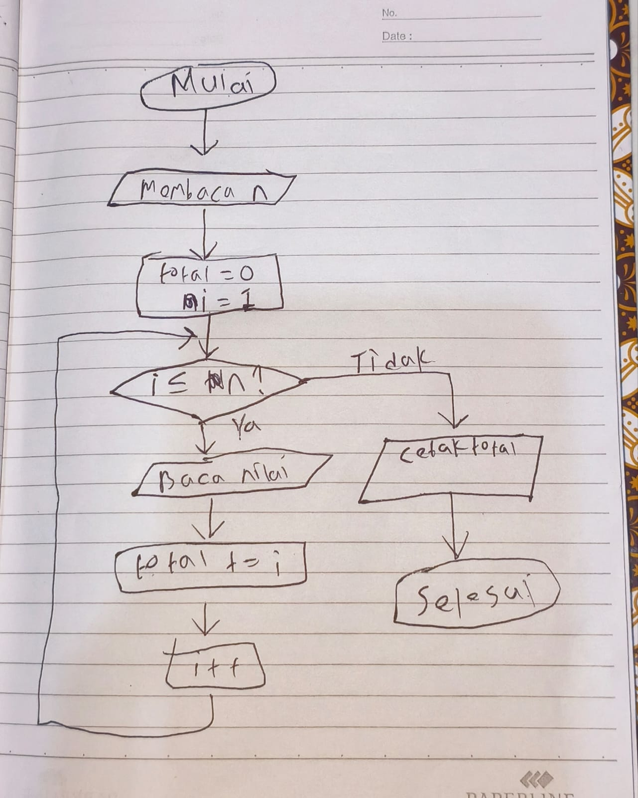
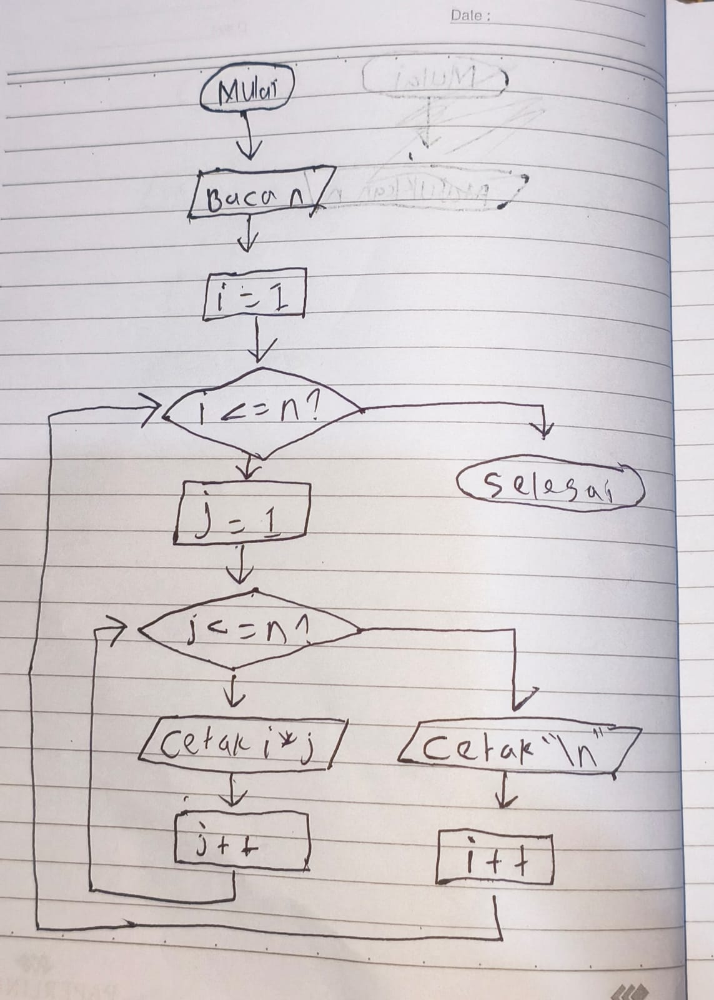

# P05 Perulangan: for, while, do-while

Folder kode Pertemuan 5 Pemrograman Terstruktur. Setiap program punya flowchart pasangannya
di modul (Gambar 1 sampai 5); perhatikan panah yang kembali ke atas, itulah perulangan.

## Isi

| Berkas | Kegunaan |
|---|---|
| `for_hitung.cpp` | for dengan jumlah putaran yang diketahui; coba ubah `<=` menjadi `<` |
| `for_jumlah.cpp` | Pola akumulator: total dan rata-rata dari n nilai; coba masukkan 0 |
| `while_sentinel.cpp` | while dengan angka negatif sebagai tanda berhenti; jumlah putaran tidak diketahui |
| `do_while_menu.cpp` | do-while untuk menu yang diulang sampai pengguna memilih keluar; switch dari Pertemuan 4 |
| `sinilai_v04_awal.cpp` | Starter SiNilai v0.4: badan v0.3 sudah ada, lengkapi do-while, for, akumulator, dan rekap |
| `contoh_masukan.txt` | Tiga mahasiswa untuk menguji v0.4 |
| `.vscode/`, `.gitignore` | Sama dengan pertemuan sebelumnya |

## Kasus uji SiNilai v0.4 (`./sinilai_v04 < contoh_masukan.txt`)

| Mahasiswa | Komponen | Nilai akhir | Huruf | Status |
|---|---|---|---|---|
| Siti Aminah | 100, 85.5, 78, 80 | 83.975 | A | Lulus |
| Budi Santoso | 80, 70, 65, 60 | 67.75 | C+ | Lulus |
| Rina Wati | 60, 50, 40, 55 | 49.5 | D | Belum lulus |

Rekap kelas: 3 mahasiswa, 2 lulus, 1 belum lulus, rata-rata kelas 67.075.
Jumlah mahasiswa 0 atau negatif harus ditanya ulang (do-while).

## Kalau program berputar tanpa henti

Tekan `Ctrl+C` di terminal. Penyebab yang paling sering: lupa langkah (`i++`), syarat yang tidak
pernah salah, atau mengetik huruf saat program meminta angka (`cin` gagal dan nilai variabelnya
menjadi 0; obatnya dibahas di Pertemuan 7).

## Yang dikumpulkan mahasiswa

Folder `p05` di repository `pt-NPM` berisi `sinilai_v04.cpp`. Lihat Modul Pertemuan 5 bagian E.

## Latihan Mandiri

1. ### Flowchart Penjumlahan

2. Tulis program yang mencetak hitung mundur dari n sampai 1, lalu "Mulai!". Bagian langkah kepala for yang
mana yang berubah?

Jawaban :

bagian (int i = n; i >= 1; i--) ini yang awalnya menjadi <= menjadi sebaliknya dan i menjadi i-- bukan i ++

3. Tulis program yang membaca nilai satu per satu sampai sentinel dan mencetak nilai tertinggi yang pernah
dimasukkan. Pikirkan: nilai awal "tertinggi" harus berapa supaya nilai pertama pasti menggantikannya?

Jawaban :

Nilai awal tertinggi adalah -1, jika sentinel-nya angka negatif dan nilai yang dihitung mulai dari 0.

5. ### Flowchart Perkalian

## Deklarasi AI

Menggunakan Ai **Chat GPT** untuk melakukan konsultasi pengerjaan tugas  dan membantu ngepush kegithub.
Kesimpulan yang ada Saya menggunakan AI 1 Untuk Pengerjaan

## Prompt dan Umpan Balik AI Chat GPT

### Prompt
penggunaan perkalian di cpp pada for

### Umpan Balik Chat Gpt

Perkalian di C++ memakai tanda *. Kalau di dalam for, perkaliannya dilakukan setiap putaran.

Contoh mencetak tabel perkalian 5:
#include <iostream>

using namespace std;

int main() {
    for (int i = 1; i <= 5; i++) {
        cout << "5 x " << i << " = " << 5 * i << "\n";
    }

    return 0;
}

Hasilnya:
5 x 1 = 5
5 x 2 = 10
5 x 3 = 15
5 x 4 = 20
5 x 5 = 25

Bagian 5 * i yang menghitung perkalian. i berubah setiap putaran: 1, 2, 3, 4, lalu 5. Jadi yang dihitung adalah 5 * 1, kemudian 5 * 2, sampai 5 * 5.

### Prompt
kalo pake cin gimana

### Umpan Balik Chat Gpt

Kalau memakai cin, kamu bisa menentukan angka yang ingin dibuat tabel perkaliannya.
#include <iostream>

using namespace std;

int main() {
    int angka = 0;

    cout << "Masukkan angka: ";
    cin >> angka;

    for (int i = 1; i <= 10; i++) {
        cout << angka << " x " << i << " = " << angka * i << "\n";
    }

    return 0;
}

Misalnya kamu mengetik 3, hasilnya:
Masukkan angka: 3
3 x 1 = 3
3 x 2 = 6
3 x 3 = 9
3 x 4 = 12
3 x 5 = 15
3 x 6 = 18
3 x 7 = 21
3 x 8 = 24
3 x 9 = 27
3 x 10 = 30

cin >> angka; menyimpan input 3 ke angka. Lalu angka * i menghitung 3 dikali 1, 3 dikali 2, sampai 3 dikali 10.

### Prompt

saya mau push dan buat folder di https://github.com/ArizaNaufalKholish-2510010223/pt-2510010223 yang dimana yang dimasukkin sinilai, jumlahan.cpp, do while menu, hitung mundur, perkalian

### Umpan Balik Chat Gpt

Saya cek gambar dan struktur repositorinya dulu supaya perintah push-nya hanya memasukkan file yang kamu sebutkan.

masukan arahanya kesaya saja jangan kamu

Oke, kamu jalankan sendiri di terminal VS Code. Folder P05_Perulangan sudah ada, jadi tidak perlu dibuat lagi. Folder itu akan muncul di GitHub saat file di dalamnya di-push.

1. Simpan semua file dengan Ctrl + K, lalu S.

2. Di terminal yang sekarang berada di P05_Perulangan, jalankan:
git remote -v

Pastikan alamatnya mengarah ke:
https://github.com/ArizaNaufalKholish-2510010223/pt-2510010223.git

3. Masukkan hanya lima file ini:
git add sinilai_v04_awal.cpp jumlahan.cpp do_while_menu.cpp hitung_mundur.cpp perkalian.cpp

Nama SiNilai di gambarmu adalah sinilai_v04_awal.cpp, jadi perintahnya mengikuti nama tersebut.

4. Periksa file yang akan dikirim:
git diff --cached --name-only

Pastikan yang muncul hanya lima file tadi. Kalau ada file lain, berhenti dulu sebelum commit.

5. Kalau sudah sesuai, jalankan:
git commit -m "Pertemuan 5: SiNilai dan latihan perulangan"
git push origin main

Setelah berhasil, buka ulang repositori GitHub. Kelima file akan berada di folder P05_Perulangan.

1. Buat folder tujuan:
mkdir -p P05_Perulangan

2. Salin lima filemu:
cp ../P05_Perulangan/{sinilai_v04_awal.cpp,jumlahan.cpp,do_while_menu.cpp,hitung_mundur.cpp,perkalian.cpp} P05_Perulangan/

3. Masukkan lima file itu ke Git:
git add P05_Perulangan/sinilai_v04_awal.cpp P05_Perulangan/jumlahan.cpp P05_Perulangan/do_while_menu.cpp P05_Perulangan/hitung_mundur.cpp P05_Perulangan/perkalian.cpp

4. Periksa:
git diff --cached --name-only

Kalau yang tampil hanya lima file tadi, lanjut:
git commit -m "Pertemuan 5: SiNilai dan latihan perulangan"
git push origin main

Tuliskan AI yang digunakan, prompt, dan umpan balik AI
