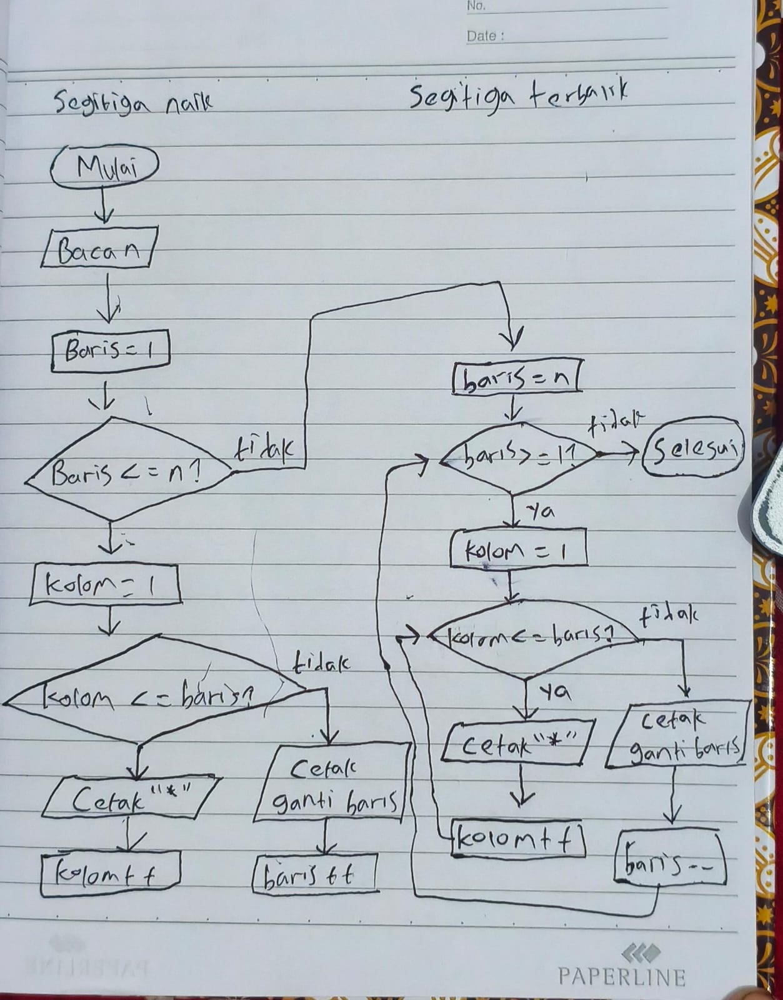

# P06 Perulangan Lanjutan: Bersarang, break, continue, Debugger, iomanip

Folder kode Pertemuan 6 Pemrograman Terstruktur. Setiap program berpasangan dengan flowchart di modul;
pada perulangan bersarang ada dua panah yang kembali, dan pada break/continue ada panah yang
"memotong jalan".

## Isi

| Berkas | Kegunaan |
|---|---|
| `bersarang_tabel.cpp` | for di dalam for: tabel perkalian dengan kolom lurus (setw) |
| `break_tebak.cpp` | break: berhenti lebih awal begitu tebakan benar, paling banyak 5 kesempatan |
| `continue_remediasi.cpp` | continue: lewati mahasiswa yang nilainya cukup, daftar hanya yang perlu remediasi |
| `rapi_iomanip.cpp` | fixed, setprecision, setw, left, right: keluaran berkolom rapi |
| `debug_rerata.cpp` | Program dengan kesalahan logika yang sengaja ditanam; dicari dengan debugger, bukan dibaca |
| `masukan_debug.txt` | Masukan untuk `debug_rerata`: 3 nilai (80, 70, 90), rata-rata yang benar 80 |
| `sinilai_v05_awal.cpp` | Starter SiNilai v0.5: v0.4 lengkap, lengkapi iomanip, penghitung huruf, tertinggi, sebaran batang |
| `contoh_masukan.txt` | Enam mahasiswa untuk menguji v0.5 |
| `.vscode/launch.json` | Konfigurasi debugger VS Code (gdb MSYS2); tekan F5 pada berkas .cpp yang terbuka |
| `.vscode/settings.json`, `tasks.json`, `.gitignore` | Sama dengan pertemuan sebelumnya |

## Kasus uji SiNilai v0.5 (`./sinilai_v05 < contoh_masukan.txt`)

| Mahasiswa | Komponen | Nilai akhir (2 desimal) | Huruf | Status |
|---|---|---|---|---|
| Siti Aminah | 100, 85.5, 78, 80 | 83.97 | A | Lulus |
| Budi Santoso | 80, 70, 65, 60 | 67.75 | C+ | Lulus |
| Rina Wati | 60, 50, 40, 55 | 49.50 | D | Belum lulus |
| Dewi Lestari | 90, 90, 90, 90 | 90.00 | A | Lulus |
| Eko Prasetyo | 75, 72, 70, 68 | 71.00 | B | Lulus |
| Fajar Nugroho | 30, 20, 35, 25 | 25.75 | E | Belum lulus |

Laporan kelas: 6 mahasiswa, 4 lulus, 2 belum lulus, rata-rata 64.66, tertinggi Dewi Lestari (90.00).
Sebaran huruf: A 2, B 1, C 1, D 1, E 1 (B+ dihitung sebagai B, C+ sebagai C).

Catatan: 83.975 tampil sebagai 83.97, bukan 83.98, karena di dalam komputer 83.975 tersimpan
sebagai 83.97499...; pembulatan mengikuti angka yang tersimpan.

## Debugger

`launch.json` memakai `C:/msys64/ucrt64/bin/gdb.exe` dan program `<nama>.exe` hasil tasks.json.
Di Linux hapus akhiran `.exe` dan ganti `miDebuggerPath` menjadi `/usr/bin/gdb`; di macOS ganti
`MIMode` menjadi `lldb` dan hapus `miDebuggerPath`. Panduan lengkap: `03_Modul/Panduan_Debugger_VS_Code.docx`.

## Yang dikumpulkan mahasiswa

Folder `p06` di repository `pt-NPM` berisi `sinilai_v05.cpp`. Lihat Modul Pertemuan 6 bagian E.

## Latihan Mandiri 1 - Flowchart segita bintang

## Latihan Mandiri 5 — Penelusuran Nilai Tertinggi

Awalnya nilai_tertinggi = -1 dan nama_tertinggi kosong.

1. Siti Aminah: 83.97 > -1, nama tertinggi menjadi Siti Aminah.
2. Budi Santoso: 67.75 < 83.97, tidak berubah.
3. Rina Wati: 49.50 < 83.97, tidak berubah.
4. Dewi Lestari: 90.00 > 83.97, nama tertinggi menjadi Dewi Lestari.
5. Eko Prasetyo: 71.00 < 90.00, tidak berubah.
6. Fajar Nugroho: 25.75 < 90.00, tidak berubah.

nama_tertinggi berubah pada  ke-1 dan ke-4.
Hasil akhir: Dewi Lestari (90.00).

## Deklarasi AI
Saya menggunakan Ai 1 untuk pengerjaan tugas, yang dimana saya menggunakan chat gpt untuk konsultasi

## Prompt dan Umpan Balik
### Prompt:
ini maksudnya apa

### Umpan Balik
Bagian Debugger di README itu menjelaskan pengaturan agar F5 bisa menjalankan debug C++:
- launch.json: mengatur cara debugger dijalankan.
- C:/msys64/ucrt64/bin/gdb.exe: lokasi aplikasi debugger GDB di Windows.
- <nama>.exe: nama program hasil kompilasi, misalnya sinilai_v05_awal.exe.
- tasks.json: mengatur perintah kompilasi C++.
- Bagian Linux dan macOS: petunjuk untuk pengguna sistem tersebut.

### Prompt
apakah sudah benar sinilai saya?

### Umpan Balik
Ya, logika SiNilai v0.5 kamu sudah benar dan TODO 1–9 sudah terpenuhi, termasuk:
- Dua angka desimal dan keluaran berkolom.
- Penghitung A–E memakai switch.
- Pembaruan nilai dan nama tertinggi tanpa break.
- Sebaran # memakai perulangan bersarang.
Pastikan simbol format chat tidak ikut masuk ke VS Code. Penulisannya harus:
#include <iomanip>
#include <iostream>
#include <string>

string nama_tertinggi;
string nama;
string npm;
string huruf_mutu;

Bukan *string*, dan perkalian menggunakan * tanpa \.

Untuk mengikuti contoh TODO 9 di modul secara persis, bagian ini bisa ditulis:

### Prompt
saya mau push berikan saya arahan
yang mana yang dipush sinilai dan readme
sisanya seperti segitigabintang,rata-rata, bilanganprima,tabel_konversi, masuk ke folder Latihan Mandiri

### Umpan Balik
Iya, susun di repo lokal pt-2510010223 seperti ini. Gunakan nama folder latihan_mandiri agar konsisten dengan p05:
p06/
├── sinilai_v05.cpp
├── contoh_masukan.txt
├── README.md
└── latihan_mandiri/
    ├── segitigabintang.cpp
    ├── rata-rata.cpp
    ├── bilanganprima.cpp
    └── tabel_konversi.cpp

contoh_masukan.txt juga ikut dikumpulkan sesuai modul. File .exe dan tempCodeRunnerFile.cpp tidak perlu dipush.
1. Di File Explorer, buka folder repo pt-2510010223 yang berisi p01 sampai p05.
2. Buat folder p06, lalu buat latihan_mandiri di dalamnya.
3. Salin file sesuai susunan di atas. Ubah nama sinilai_v05_awal.cpp menjadi sinilai_v05.cpp.
4. Edit dan simpan README lewat VS Code. Jika README memuat perintah menjalankan program, sesuaikan namanya menjadi sinilai_v05.
5. Buka Git Bash di folder repo pt-2510010223, lalu jalankan satu per satu:
git status

git add p06/sinilai_v05.cpp p06/contoh_masukan.txt p06/README.md

git add p06/latihan_mandiri/*.cpp

Periksa daftar file yang akan dikirim:
git diff --cached --name-only

Jika sudah sesuai susunan tadi, lanjutkan:
git commit -m "Pertemuan 6: SiNilai v0.5 dan latihan mandiri"

git push origin main

Terakhir, cek:
git status

Pastikan terminal berada di repo pt-2510010223, bukan hanya folder bahan pestruk. Semua langkah ini dikerjakan dari komputer, sesuai ketentuan dosen.
Tuliskan AI yang digunakan, prompt, dan umpan balik AI